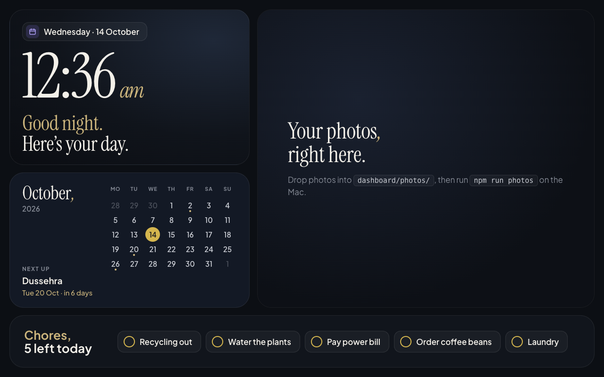
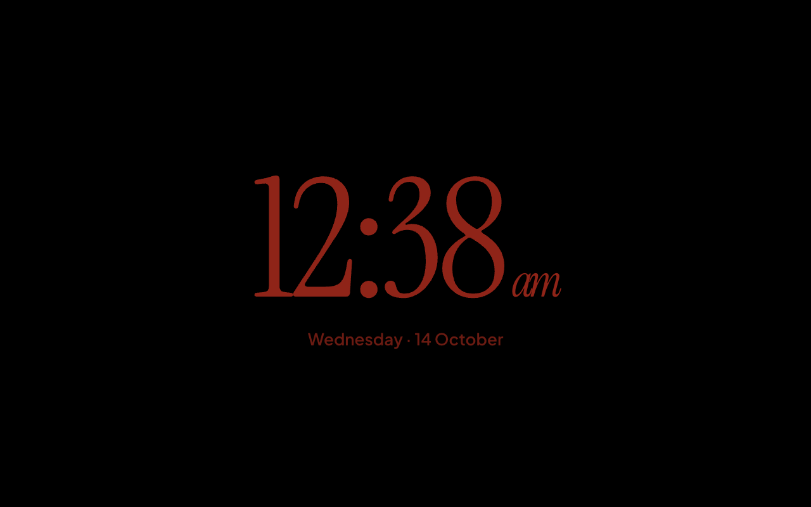

# Glance

A calm home dashboard for a cheap Android photo frame: the time, this month, your photos and
today's chores, readable from across the room.



Glance runs on a 10.1" photo frame bought for its screen: a budget quad-core chip, 1 GB of RAM
and Android 6, whose newest browser engine is Chromium 107. The whole dashboard is one static web page,
about 8 KB of gzipped JavaScript and CSS plus fonts, built to stay smooth on that hardware and to
keep running for weeks with nobody touching it.

## Features

- **Clock and greeting.** A large serif clock with a greeting that follows the day
  ("Good morning." through "Good night.").
- **Month calendar.** Today highlighted, dots on the dates you care about (birthdays repeat
  every year), and the next one with a countdown: *Diwali, Sun 8 Nov · in 4 weeks*.
- **Photos.** Your own photos crossfade in the large tile. A script shrinks them to the frame's
  size first, HEIC included, so the frame never decodes a 12-megapixel original.
- **Chores.** Tap to tick off. Ticks are saved on the frame and reset each morning.
- **Night clock.** After 10 p.m., two idle minutes turn the screen into a dim red clock on black.
  It drifts a few pixels now and then so it doesn't burn in. One tap brings the dashboard back.
- **Runs unattended.** It reloads itself if it fails to start and once a day at 3 a.m., and it
  waits out the frame's clock reading 1970 after a power cut.



## Built for an old, slow browser

The frame's WebView is Chromium 107 on Android 6. On frames like this one it has rejected 8-digit
hex colours and `:has()`, it can't verify Let's Encrypt certificates, and its GPU struggles with a
single blur. Glance treats that as a design constraint rather than a bug list.

- **Build targets** pinned to Chrome 106 for JS and Chrome 61 for CSS, so the minifier never emits
  syntax the frame rejects.
- **A compatibility check** ([`check-compat.mjs`](dashboard/scripts/check-compat.mjs)) runs after
  every build and in CI, and fails on CSS and JS the frame can't run.
- **No framework.** Plain ES modules; each tile renders a string of HTML and only the clock
  updates every minute.
- **Nothing from the internet at runtime.** Fonts are bundled, photos are pre-sized, and the
  frame only ever talks to one origin on the LAN.
- **A `?diag` overlay** shows fps, long frames, DOM size, decoded image megapixels and heap on the
  device itself.

The full list, with reasons, is in [docs/frame.md](docs/frame.md).

## How it works

```
 Photo frame (Android 6)                         Mac on the same Wi-Fi
 ┌──────────────────────────┐   HTTP on the LAN   ┌──────────────────────────┐
 │ Kiosk app (fullscreen    │ ──────────────────▶ │ Vite: serves the built   │
 │ WebView, set as Home)    │                     │ page, fonts and photos   │
 └──────────────────────────┘                     └──────────────────────────┘
```

The frame boots straight into a fullscreen kiosk app that loads one URL. Today that URL is the
built dashboard on a Mac. Later a home server takes its place and adds live data (weather, news,
music) behind the same page; see the [roadmap](docs/roadmap.md).

## Getting started

Needs Node 22+ and macOS (the photo script uses the built-in `sips`).

```sh
cd dashboard
npm install
npm run dev            # http://localhost:5173; open it at 1280 × 800
```

Make it yours:

- **Dates and chores:** edit [`dashboard/src/content.js`](dashboard/src/content.js).
- **Photos:** copy them into `dashboard/photos/` and run `npm run photos`. Photos stay on your
  machine; both photo folders are gitignored.

Put it on the frame:

```sh
npm run build && npm run preview     # serves on port 4173
adb shell am start -n com.wesbos.homehq/.MainActivity --es url http://<your-mac-ip>:4173/
```

This assumes a frame that already has ADB and a kiosk app. Getting there (unlocking, rooting,
installing the kiosk) is device-specific; Wes Bos's
[photo-frame-dashboard](https://github.com/wesbos/photo-frame-dashboard) has guides for many
models. For this frame, [docs/connect-the-frame.md](docs/connect-the-frame.md) walks through
connecting it to a Mac and getting the dashboard on it.

## Project layout

```
dashboard/              the web app
  src/
    main.js             minute tick, daily reload, wiring
    content.js          the file you edit: dates, chores, timings
    tiles/              clock, calendar, photo, chores
    night.js            night clock
    diag.js             ?diag performance overlay
    style.css           design tokens and all styles
  scripts/              photo resizer, frame-compatibility check
  test/                 unit tests (node --test)
scripts/
  frame-check.sh        read-only report of the frame over ADB
docs/
  roadmap.md            phases, from static dashboard to home server
  design.md             design language: layout, tokens, type
  frame.md              the hardware, its browser's limits, serving and setup
  connect-the-frame.md  step-by-step: Mac setup, USB connection, checks, first run
  ideas.md              ideas not yet scheduled
```

## Development

```sh
cd dashboard
npm test               # unit tests for the date and calendar logic
npm run build          # production build, then the compatibility check
```

CI runs both on every push and pull request.

## Credits

Inspired by Wes Bos's [photo frame video](https://youtu.be/ZLycoUMltNI) and
[repository](https://github.com/wesbos/photo-frame-dashboard),
[kitchen-frame](https://github.com/huntsyea/kitchen-frame) and
[Mado](https://github.com/abradburne/mado). See [CREDITS.md](CREDITS.md).

## License

[MIT](LICENSE) © 2026 Venkat Kandhipati
