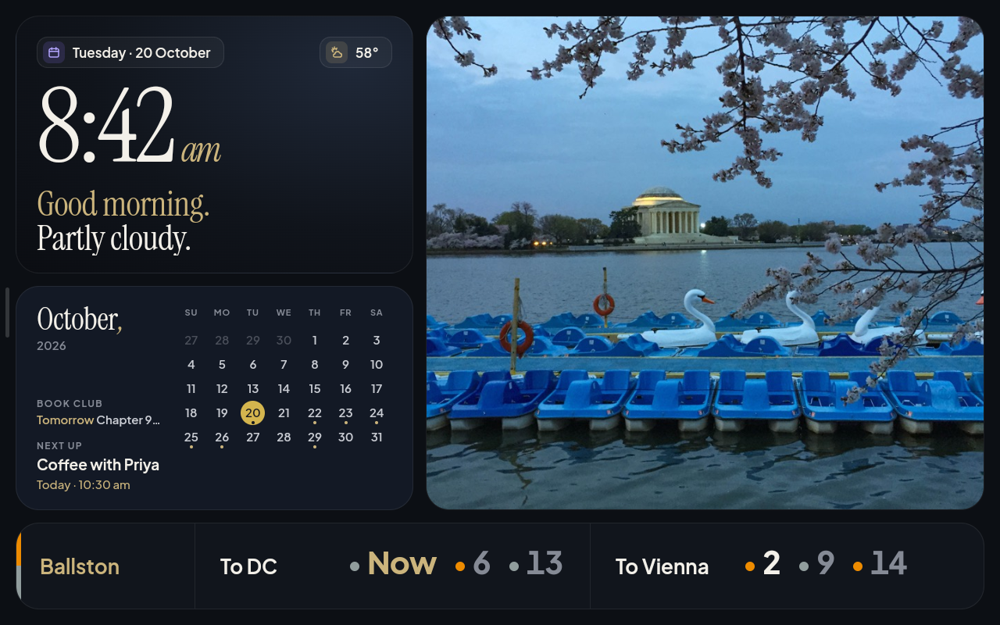

# Design

Calm, dark, glanceable: something you read from across the room in two seconds. Every tile
answers one question, and every pixel has to be cheap for an old phone GPU to paint.

## Target

The long-term design is a seven-tile board: clock, top news, weather, last played, next match,
air quality and chores. The MVP keeps its visual language and swaps the tiles that need live data
for ones that don't (calendar, photos). The rest return once the home server exists
([roadmap](roadmap.md)).



## Layout

A fixed 1280 × 800 grid (the frame's exact resolution at DPR 1), 20 px outer margin, 16 px gaps.

```
┌────────────────────────┬─────────────────────────────────┐
│ Clock      509 × 330   │                                 │
├────────────────────────┤ Photo            715 × 633      │
│ Calendar   509 × 287   │                                 │
├────────────────────────┴─────────────────────────────────┤
│ Metro                                        1240 × 111  │
└──────────────────────────────────────────────────────────┘
```

## Tokens

All in [`dashboard/src/style.css`](../dashboard/src/style.css) as custom properties.

| Token | Value | Use |
| --- | --- | --- |
| `--ground` | `#0c0f14` | Page background |
| `--tile` | `#11151c` | Default tile surface |
| `--tile-blue` | `#131925` | Calendar tile (each tile gets its own faint tint) |
| `--tile-line` | `rgba(255,255,255,.07)` | 1 px tile border |
| `--chip` / `--chip-line` | `rgba(255,255,255,.04)` / `.09` | Pills: date |
| `--ink` / `--ink-2` / `--mute` | `#f3f0e9` / `#c9ccd3` / `#858a95` | Text, from primary to quiet |
| `--gold` / `--gold-fill` | `#cbb47c` / `#d4b54e` | Accent text, today, ticks |
| `--violet` | `#b4a6ff` | Icon chips |
| `--night` | `#8f2418` | Night clock |
| `--r` / `--r-chip` | `30px` / `14px` | Tile and pill radii |

## Type

- **Instrument Serif** for display: the time, the greeting, the month. Italic for small flourishes
  (am/pm, the gold comma in "October,").
- **Plus Jakarta Sans** (variable) for everything else: labels, pills, the Metro banner's text.
- Both are bundled as woff2 through Fontsource. The frame never loads fonts from the web.

## Patterns

- **Two-tone headings:** a gold first line and a white second ("Good night. / Here's your day.",
  "Ballston, / Next trains").
- **Pills** for metadata and actions, with an optional 28 px tinted icon chip at the start.
- **Done state:** filled gold circle with a dark tick, muted strikethrough label.
- **Metro banner:** a 6 px stripe in the station's line colours down the left edge; the title is
  just the station name in gold (a quiet second line appears only for "Checking…" or old times);
  per direction, its name ("To DC") and the next three times in bold sans with tabular figures (like WMATA's Helvetica signs), each after a 12 px dot in
  its line's colour. The next train is ink, the two after it muted; arriving or boarding reads
  "Now" in gold. No destinations or units. WMATA line colours: Orange `#ed8b00`, Silver
  `#919d9d`, Red `#bf0d3e`, Blue `#009cde`, Yellow `#ffd100`, Green `#00b140`.
- **Weather:** a pill at the clock tile's top right (gold-tinted icon chip, the temperature now)
  and the greeting's second line ("Mostly sunny.", "Rain from 4 pm."). Without a forecast the line
  falls back to "Here's your day."
- **Calendar agenda:** under the month, a quiet calendar's line (small-caps name, then the day in
  gold and the event) and *Next up* (label, title clamped to two lines, gold when-line). Only
  non-quiet calendars and marked dates put dots on the grid.
- **Screens** (Week, Transit, Weather): a serif heading with a gold comma ("This week,") and a
  muted note beside it, then tiles in the board's style. Calendars keep one colour each, in
  `content.js` order: gold, violet, teal, rose; quiet calendars are muted grey.
- **Side bar:** 120 px, hidden off the left edge with a faint 5 px handle showing; 100 px tall
  buttons (icon and label), the current screen tinted gold. It slides in and out (transform only).
- **Day sheet:** a panel over a dimmed screen: the day in serif, 76 px round ‹ › buttons, then each
  event with its time in its calendar's colour and a bar of the same colour.
- **Weather warning:** the temperature pill turns red (`rgba(191, 13, 62, 0.18)` with `#ffd6df`
  text and a warning sign), and the greeting's second line names the warning in `#f2a7b8`.
- **App icon:** a gold (`#cbb47c`) G drawn as one round-capped stroke, like a clock face with a
  hand at three, on the tile colour `#11151c`.
- **Public pictures:** only dark ones (average brightness under 0.38, under 8% near-white), so
  they sit with the navy: night skies, forests, nocturnes, dark paintings. Paintings and astronomy
  pictures are shown whole and never enlarged (`object-fit: scale-down`)
  on the tile's dark ground; photos fill the tile. A credit line sits in a dark pill
  (`rgba(8, 10, 14, 0.7)`, 14 px) at the bottom left and fades with the picture.
- **Pomodoro:** the timer tile on the left (500 px), tinted `--tile-blue` while deep work runs: a
  280 px ring that empties as time runs out (gold for work, teal `#7cc6b8` for the break), the
  time left in serif, then category chips and the action button, all 76 px tall. The start
  button is filled gold; "Stop" turns red-tinted and asks for a second tap. A phase ending
  pulses the tile gold (opacity only). Categories take the calendar colours in `content.js`
  order, then sky `#78b9e6` and grey. On the right: Today (count of goal, dots), Streak, All
  time; the last 7 days as stacked bars by category with a dashed goal line; 12 weeks as
  18 px squares in four steps of gold; minutes by category as thin bars.
- **Touch:** every target is at least 76 px, because the frame reads taps low (docs/frame.md).
- **No** shadows, blur, gradients that animate, or motion other than photo crossfades, the side
  bar's slide and the night clock's drift.
